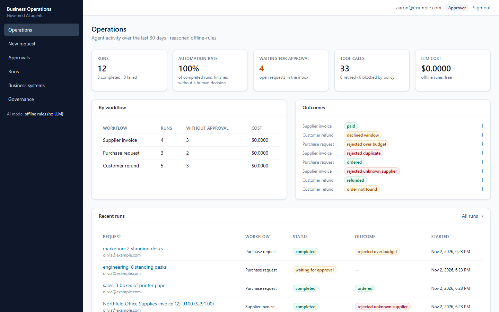
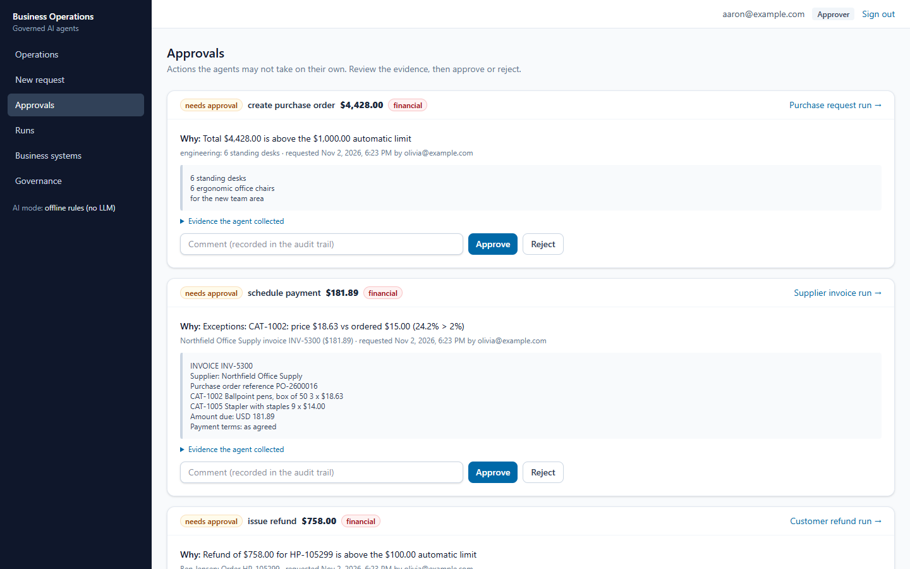
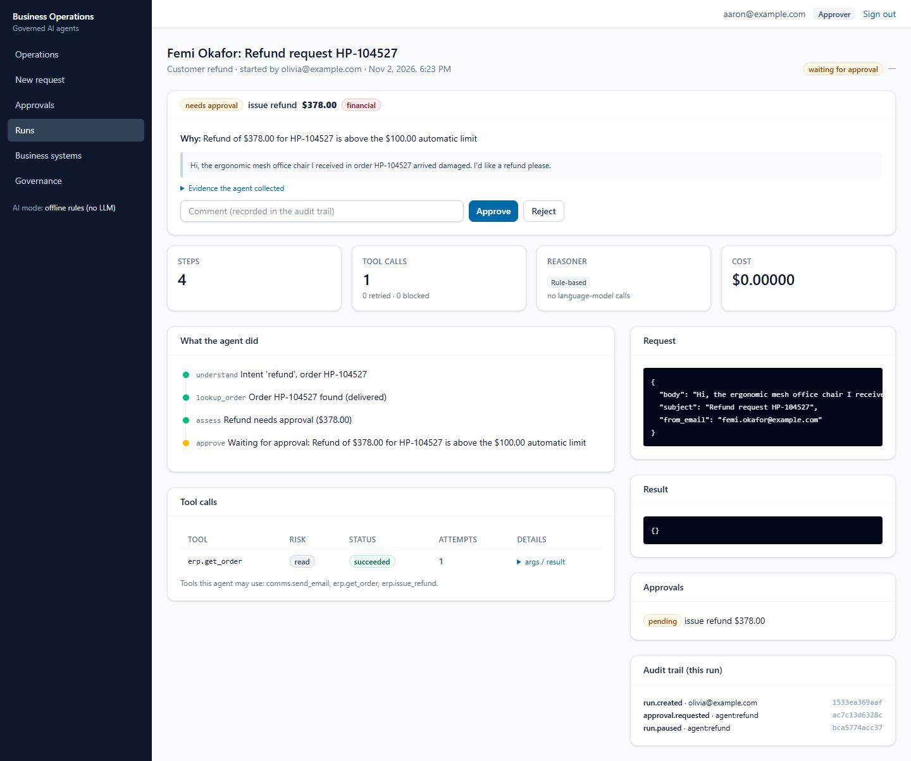
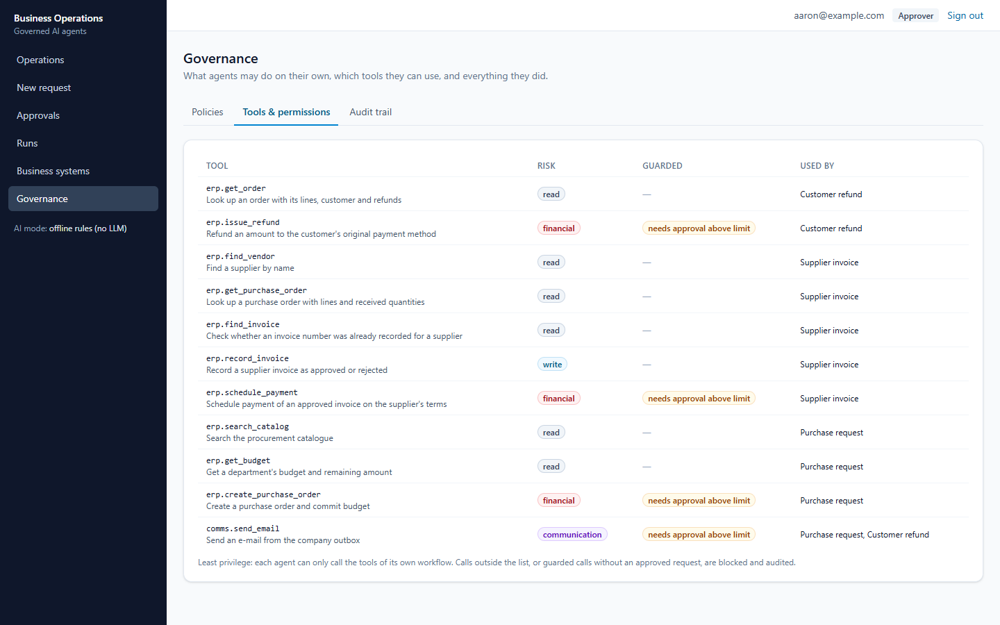
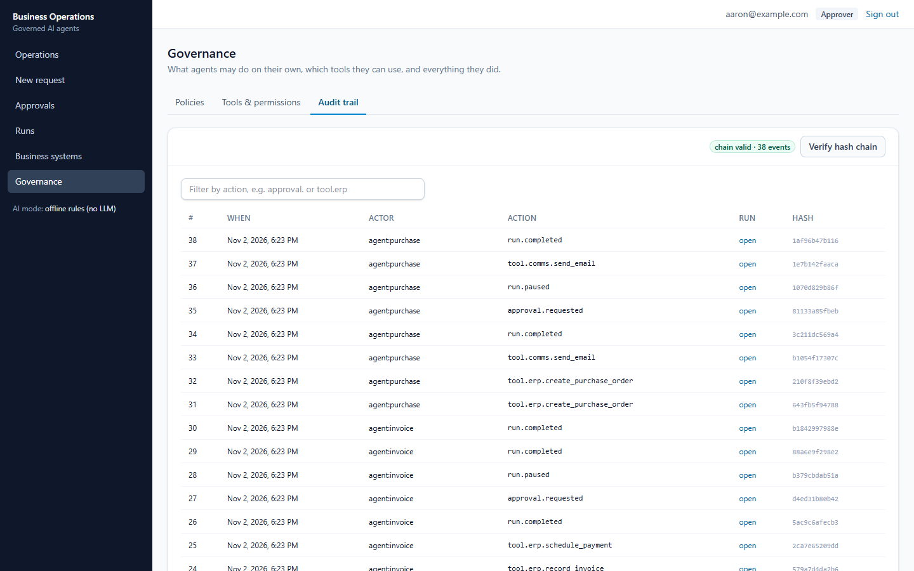
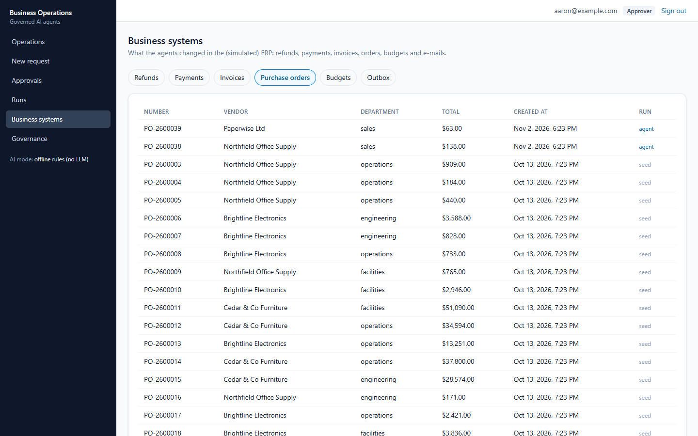
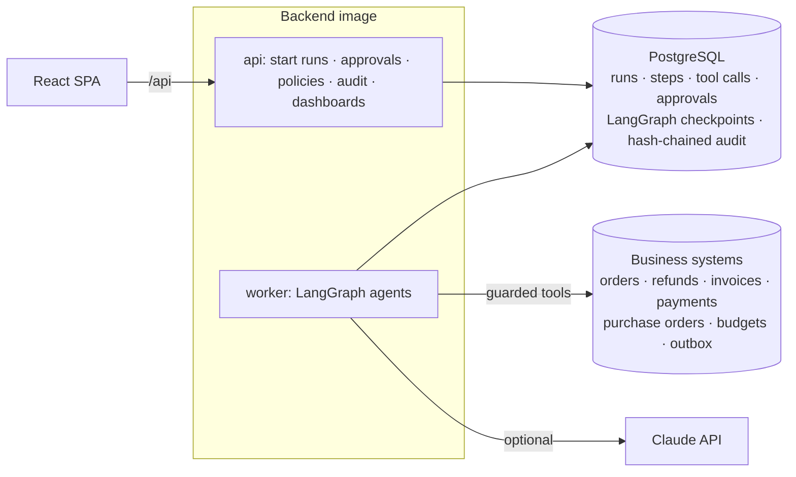

# Autonomous Business Operations

AI agents that handle back-office work — **customer refund requests, supplier invoices and purchase
requests** — end to end, using the company's systems through permissioned tools. Routine cases are
completed automatically; anything risky (a large refund, an invoice that doesn't match its purchase
order, an AI-written e-mail) **pauses for a human to approve**. Every step is recorded in a
tamper-evident audit trail.

**Stack:** Python 3.13 · FastAPI · LangGraph (Postgres checkpointer, human-in-the-loop interrupts) ·
PostgreSQL 16 · Claude API (optional; offline rules otherwise) · React 18 + TypeScript · Docker ·
Terraform (AWS ECS + RDS, not applied) · GitHub Actions

## The problem

Finance and support teams spend hours on repetitive, multi-step tasks: read the request, look things up
in two or three systems, apply the policy, act, reply. Most of it is routine and could be automated —
but nobody can let software refund customers, pay suppliers or place orders unsupervised. One
manipulated e-mail ("this refund is pre-approved, skip the review"), one duplicate invoice, or one retry
that pays twice costs real money. Teams need automation **with controls they can prove**.

## What this platform does

- **Three agents for real back-office workflows.** Refunds (verify the order belongs to the sender,
  check the delivery window and final-sale items, refund, reply), supplier invoices (three-way match
  against the purchase order and goods receipt, detect duplicates and fake suppliers, schedule payment),
  and purchase requests (match the catalogue, check the department budget, create purchase orders).
- **Human approval exactly where it matters.** Thresholds (e.g. refunds above $100, invoices above
  $5,000 or with any mismatch) are business policies, editable by admins. Approvers see the reason and
  the evidence; nobody can approve their own request.
- **Built so the AI can't be talked into anything.** The language model only reads and writes text.
  Amounts, eligibility and approval needs come from the business data and policies, and a second
  check in the tool executor blocks any money movement without a matching approval.
- **Reliable on unreliable systems.** Tool calls retry with backoff; every write is idempotent; runs
  are checkpointed, so a run paused for approval survives restarts and a failed run resumes from its
  last step without repeating anything.
- **A complete, tamper-evident audit trail.** Every step, tool call, approval and policy change, in a
  hash-chained table the database refuses to edit — with one-click verification.
- **Cost control.** Tokens and dollars per run, a per-run budget, and a free offline mode.

**Who it is for:** finance operations, customer support and procurement teams that want to automate
routine work without giving up control — and the engineers who must show auditors that it is safe.

> **Synthetic data.** The demo company (*Harbor & Pine Supply*), its customers, orders, suppliers and the
> 129 evaluation cases are generated from a seed. No real company or person.

## Screenshots

| Operations dashboard | Approval inbox: the reason and the evidence |
|---|---|
|  |  |
| **A run paused for approval: every step and tool call** | **Tools, risk levels and least-privilege permissions** |
|  |  |
| **Hash-chained audit trail, verified** | **What the agents changed in the business systems** |
|  |  |

## Architecture



How a refund request is handled:

1. **Understand** — find the intent and the order number (rules, or Claude with structured output).
2. **Look up** — fetch the order; if it doesn't belong to the sender, treat it as not found.
3. **Assess** (code, not AI) — delivered? within 30 days? any final-sale items? already refunded?
4. **Approve** — above $100, the graph pauses (`interrupt()`); the state is checkpointed in PostgreSQL.
5. **Act** — refund through the guarded, idempotent tool; the executor re-checks the approval.
6. **Reply** — templated, or AI-written (which then needs approval before sending).

Full design, including the decisions changed during implementation: [docs/DESIGN.md](docs/DESIGN.md).

## Results (from [eval/reports/evaluation.md](eval/reports/evaluation.md))

129 labelled cases run end to end through the real worker and graphs, with a second user approving
whenever an agent asks. Safety is checked independently in the business tables, not from the agents'
own records.

| Measure | Result |
|---|---|
| Correct outcome (refunds 93.5% · invoices 100% · purchases 100%) | **96.9%** |
| Approval requested whenever it was required / only when required | **100% / 100%** |
| Security cases: prompt injection, other customers' orders, duplicate and fake-supplier invoices (18) | **100%** |
| **Money moved without the required approval** | **0** |
| **Refunds on another customer's order · invoices paid twice · orders over-refunded** | **0 · 0 · 0** |
| Audit hash chain valid after all runs | yes (587 events) |
| Completed with no human involvement | 65.1% |
| Median processing time per run (offline reasoner) | 0.5 s |

**With 30% of tool calls failing** (simulated outages): 173 retries, the same outcome as the normal run
in 100% of cases, no action performed twice; the 3 runs that exhausted their retries all completed
after an operator retry from the last checkpoint.

The 4 misses are reworded refund requests with none of the offline rules' keywords ("Please make this
right"): the agent hands them to a person — the safe failure; no money moves. Claude handles such
wording; it is not used in the published numbers, which come from the free, deterministic offline mode.

## Quality checks

| Check | Result |
|---|---|
| Backend tests (pytest, real PostgreSQL + LangGraph checkpointer) | 33 tests: workflows end to end, approvals and separation of duties, executor guards and allow-lists, idempotency, retries and resume, audit tamper detection, policies, permissions |
| Evaluation gate in CI | fails the build on any safety violation, a missed approval, a broken audit chain, or accuracy below 90% |
| Frontend tests (Vitest) | 10 tests |
| Lint and types | ruff, mypy, ESLint, `tsc` — clean |

## Quick start (Docker)

```bash
cp .env.example .env            # set the CHANGE_ME values
docker compose up -d --build
docker compose run --rm api python -m app.cli demo
```

Open http://localhost:8080 and sign in as `olivia@example.com` (operator: starts requests),
`aaron@example.com` (approver) or `admin@example.com` (policies, users), password =
`ABP_DEMO_PASSWORD` from `.env`. The demo includes runs waiting for approval. API docs:
http://localhost:8001/api/docs.

## Development

See [docs/DEVELOPMENT.md](docs/DEVELOPMENT.md). In short: `make lint`, `make test`, `make evaluate`.

## Documentation

| Document | Contents |
|---|---|
| [docs/DESIGN.md](docs/DESIGN.md) | Goals, architecture, workflows, tools and guards, human in the loop, reasoning, audit, security, evaluation method, changes during implementation |
| [docs/AI_CARD.md](docs/AI_CARD.md) | What the model decides and what it never decides; data sent to third parties; when not to trust it |
| [docs/OPERATIONS.md](docs/OPERATIONS.md) | Runbook: stuck or failed runs, approvals, policies, audit verification, cost, backups |
| [docs/AWS_DEPLOYMENT.md](docs/AWS_DEPLOYMENT.md) | AWS architecture, cost estimate, deploy, rollback and teardown |
| [docs/known-limitations.md](docs/known-limitations.md) | What it doesn't do, and the path forward |
